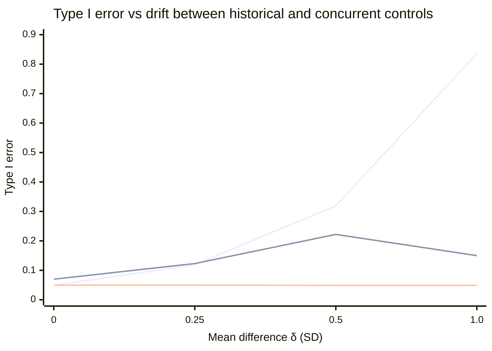

# Adjust or Replace?

**A simulation study comparing digital twin–based covariate adjustment and virtual control groups in animal experiments**

Presented at the **XXVII National and X International Biostatistics Congress (UBK2026)**, İzmir, Türkiye, 11–14 November 2026.

**Authors:** Bilge Yılmaz (presenting author), Kubilay Doğan Kılıç (corresponding author, [ORCID 0000-0002-9484-0777](https://orcid.org/0000-0002-9484-0777)), Yiğit Uyanıkgil  
Department of Histology and Embryology, Faculty of Medicine, Ege University, İzmir, Türkiye  
Contact: kubilay.dogan.kilic@ege.edu.tr

## The question

Historical control data can reduce the number of animals in an experiment in two ways:

- **Replace:** use historical controls in place of part of the concurrent control group (virtual controls).
- **Adjust:** use historical data to build a prognostic model (a "digital twin") that predicts each new animal's outcome under control; the prediction enters analysis of covariance (ANCOVA) as a covariate, and the experiment stays fully randomized.

Which use reduces animal numbers without increasing false-positive findings?

## Simulation design (ADEMP)

- Two-arm randomized experiments with a continuous outcome.
- Design effect size 1.0 or 1.5 SD (17 or 9 animals per group for 80% power with a t-test); twin–outcome correlation ρ = 0–0.9; loss of this correlation in the new experiment η = 0, 0.2, 0.4; mean difference between historical and concurrent controls δ = 0–1 SD; 20 or 50 historical controls.
- 240 scenarios, each run 10,000 times under the null and the alternative hypothesis.
- Methods: t-test (reference); ANCOVA with the sample size reduced by the 1 − ρ² rule; the same plus one animal per group; naive pooling (concurrent controls halved, all historical controls added); test-then-pool (pool only if p ≥ 0.10).
- The digital twin is idealized: its prediction is generated with a prespecified correlation with the outcome, not by a model trained on real historical data.

## Key results

| Strategy | Animals saved | Type I error | Power |
|---|---|---|---|
| Prognostic ANCOVA, ρ = 0.7, rule + 1 animal per group | 33–41% | 0.048–0.052 in all scenarios | 0.82–0.86 |
| Naive pooling | 22–24% | 0.05 without drift; 0.08–0.12 at δ = 0.25 SD; up to 0.84 at δ = 1 SD | 0.89–0.98 without drift |
| Test-then-pool | 22–24% | about 0.07 even without drift; up to 0.25 with drift | — |

If the twin's correlation falls from 0.7 to 0.5 or 0.3 in the new experiment, the power of the adjusted design drops to 0.66–0.72 or 0.58–0.64, while its type I error is unaffected.

Type I error as historical and concurrent controls drift apart (17 animals per group, 50 historical controls). Lines from top to bottom at δ = 1 SD: naive pooling, test-then-pool, prognostic ANCOVA (rule + 1).



**Take-home:** use historical control data to **adjust**, not to **replace**. In small experiments, plan n₀(1 − ρ²) + 1 animals per group (rounded up), estimate ρ on data independent of those used to build the twin, and reduce the sample only when ρ is at least moderate (≥ 0.5).

## Reproduce

```bash
pip install -r requirements.txt
python simulation.py 10000 results_10000.csv
```

The run takes about a minute with the fixed seed 20261005 and writes `results_10000.csv`: one row per scenario, hypothesis and method, with the rejection rate (type I error under the null, power under the alternative), bias, 95% CI coverage and number of animals.

## Files

| File | Content |
|---|---|
| `simulation.py` | Complete simulation: data generation, five analysis methods, performance measures |
| `requirements.txt` | Python packages needed to run the simulation |
| `CITATION.cff` | Citation information |
| `LICENSE` | MIT license |

## Türkçe özet

Bu çalışmada tarihsel kontrol verilerinin hayvan sayısını azaltmak için iki kullanım yolu Monte Carlo simülasyonuyla karşılaştırıldı: eş zamanlı kontrollerin bir kısmının yerine konması (sanal kontrol) ve bir dijital ikiz modelinin tahmininin ANCOVA'da ortak değişken olarak kullanılması. Dijital ikizle düzeltme tip I hatayı her senaryoda nominal düzeyde tuttu ve ρ = 0,7'de hayvan sayısını %33–41 azalttı. Sanal kontroller ise tarihsel ve eş zamanlı kontroller arasında küçük bir fark olduğunda bile tip I hatayı şişirdi. Tarihsel veriler eş zamanlı kontrollerin yerine konmak yerine hesaba katılmak için kullanılmalıdır.

## Citation

Yılmaz B, Kılıç KD, Uyanıkgil Y. Adjust or Replace? A Simulation Study Comparing Digital Twin-Based Covariate Adjustment and Virtual Control Groups in Animal Experiments. XXVII National and X International Biostatistics Congress (UBK2026), İzmir, Türkiye, 2026.

## License

MIT
